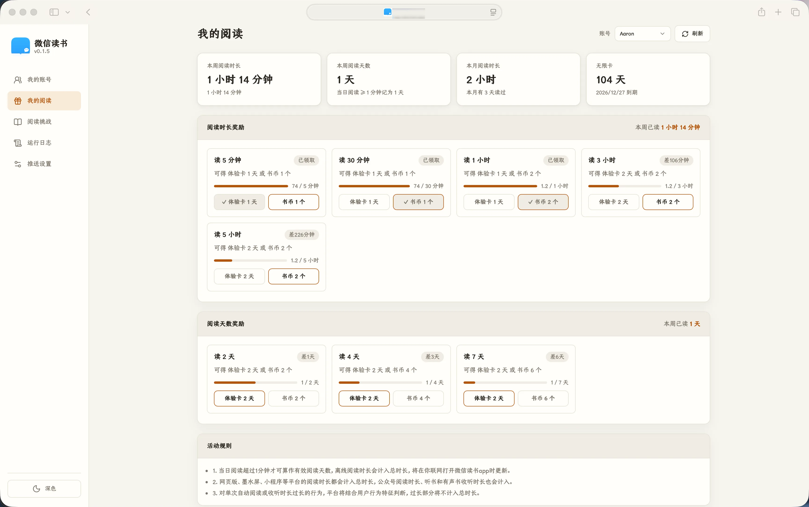
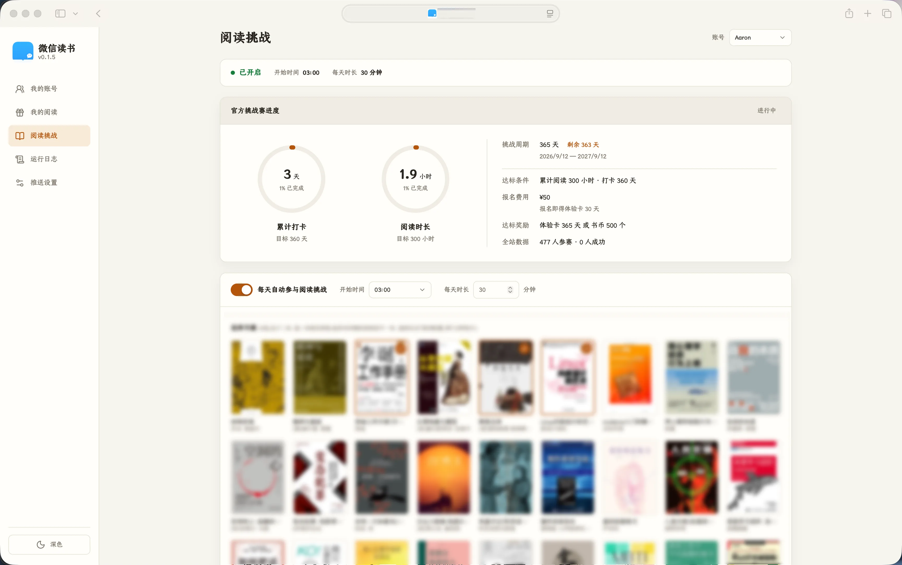

# WeRead-Kit

[简体中文](README.md) | English

[](https://github.com/27Aaron/WeRead-Kit/actions/workflows/release.yml) [](https://github.com/27Aaron/WeRead-Kit/releases) [](https://github.com/27Aaron/WeRead-Kit/pkgs/container/weread-kit) [](https://go.dev/)

A self-hosted web console for [WeChat Read (微信读书)](https://weread.qq.com/) accounts. It runs the daily reading challenge on a schedule, claims weekly reading rewards, and sends notifications when a run finishes or fails.

The web console is in Chinese only. Menu names below are followed by their Chinese labels so you can find them in the UI.

## Screenshots

 

## Features

- **Daily reading challenge**: reads from your book list at a set time for a set number of minutes each day. When you pick several books, one is chosen at random. You can also start a run by hand, and a run interrupted by a crash resumes on the next start.
- **Automatic reward claims**: pick a reward tier and prize once, and the same prize is claimed every week as soon as it is unlocked.
- **Notifications**: Bark, Telegram, ServerChan (Server酱) and PushPlus, sent when a run completes, is interrupted or fails.
- **Local account storage**: log in by scanning a QR code with WeChat. Credentials and settings stay in a local SQLite database.
- **Multiple accounts**: each account has its own reading challenge and reward settings.
- **Optional password**: with a username and password set, the console requires login. Sessions last 7 days, and changing the username or password and restarting signs out every existing session. Cookies are SameSite, and cross-origin requests are rejected.
- **Run log**: filter by account and level to see scheduling, credential renewal, reading reports and notification results.
- **Web console**: light and dark themes, works on phones.

## Quick start

Once running, open <http://127.0.0.1:8080>. Account data is written to `data/weread.db` in the current directory by default.

### Docker

```bash
docker run -d --name weread-kit \
  -p 8080:8080 \
  --stop-signal SIGINT \
  -e WEREAD_HOST=0.0.0.0 \
  -v weread-data:/data \
  ghcr.io/27aaron/weread-kit:latest
```

> `--stop-signal SIGINT` lets the app shut down cleanly when the container stops, instead of being killed after the timeout.

The container listens on `0.0.0.0`, so anyone who can reach port 8080 can manage accounts and read credentials. If the port is open to your LAN or the internet, add `-e WEREAD_USERNAME=... -e WEREAD_PASSWORD=...` to require login. Without a password, the app prints a warning at startup.

The repository also ships a `compose.yaml`: clone it and run `docker compose up -d`.

### Prebuilt binaries

Download a build from [Releases](https://github.com/27Aaron/WeRead-Kit/releases). Builds are published for Linux, macOS and Windows, on amd64 and arm64.

```bash
chmod +x weread-kit-<platform>
./weread-kit-<platform>
```

### Nix

Run or install the program from the flake:

```bash
# Run without installing
nix run github:27Aaron/WeRead-Kit

# Install into the current profile
nix profile install github:27Aaron/WeRead-Kit
```

Or add it as an input to your own flake:

```nix
{
  inputs.weread-kit.url = "github:27Aaron/WeRead-Kit";
}
```

### From source

```bash
go run ./cmd/weread-kit
# or
go build -o weread-kit ./cmd/weread-kit && ./weread-kit
```

Requires Go 1.26 or later. `nix develop` provides a ready development shell.

## Getting started

1. **Add an account**: go to My Accounts (我的账号), click Add Account (添加账户), and scan the QR code with WeChat.
2. **Set up the reading challenge**: open Reading Challenge (阅读挑战), select at least one book, set the daily start time and duration, and save.
3. **Turn on the schedule**: enable the daily reading switch (每天自动参与阅读挑战). Runs follow the schedule, and an unfinished run resumes after a crash or restart.
4. **Choose rewards**: on My Reading (我的阅读), pick a prize for a reward tier. The same prize is claimed automatically every week.
5. **Set up notifications**: fill in a channel under Notifications (推送设置) and send a test message.
6. **Check the log**: when something goes wrong, filter Run Log (运行日志) by account and level first.

## How it behaves

- A reading run reports progress every 30 seconds, and the page shows the current progress.
- If you stop a run yourself, it does not resume that day. A crash, restart or abnormal exit resumes it on the next start.
- When a session expires, the app renews it automatically and saves the new credentials to the database right away. If renewal keeps failing, refresh the account on My Accounts, and scan the QR code again if needed.
- The daily start time uses the process's time zone. The Docker image defaults to `Asia/Shanghai`. A binary uses the system time zone, so on a UTC server set `TZ=Asia/Shanghai`.
- Deleting an account removes only local data (credentials, reading settings, run log entries and reward choices). Your WeChat Read account is not affected.
- Data lives in `data/weread.db`. Back up the whole `data/` directory, preferably with the service stopped.

## Configuration

Copy `.env.example` to `.env`, or set environment variables:

| Variable | Default | Purpose |
| --- | --- | --- |
| `WEREAD_HOST` | `127.0.0.1` | Listen address; use `0.0.0.0` in a container |
| `WEREAD_PORT` | `8080` | Web port |
| `WEREAD_DB` | `data/weread.db` | SQLite database path |
| `WEREAD_USERNAME` | empty | Console login username; set together with the password |
| `WEREAD_PASSWORD` | empty | Console login password |
| `TZ` | system time zone (`Asia/Shanghai` in the image) | Time zone used for the daily schedule |

## Development

```bash
nix develop
go test ./...
go build ./...
gofmt -l .
```

## Changelog

- [Release notes](CHANGELOG.md) (in Chinese)

## References

- [findmover/wxread](https://github.com/findmover/wxread)
- [teng-lin/weread-omni](https://github.com/teng-lin/weread-omni)

## Disclaimer

This project is for personal learning and research only. Follow the WeChat Read user agreement and keep usage at a reasonable rate. You are responsible for any account, data or other issues that arise from using this project.
